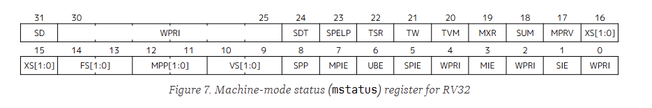

# INTEL 80386 PROGRAMMER'S REFERENCE MANUAL 1986
第96页
The selector portion of a logical address identifies a descriptor by
specifying a descriptor table and indexing a descriptor within that table
# 状态机
0: mov  r1, 0         |  pc0: r1 = 0;
1: mov  r2, 0         |  pc1: r2 = 0;
2: addi r2, r2, 1     |  pc2: r2 = r2 + 1;
3: add  r1, r1, r2    |  pc3: r1 = r1 + r2;
4: blt  r2, 100, 2    |  pc4: if (r2 < 100) goto pc2;   // branch if less than
5: jmp 5              |  pc5: goto pc5;

(PC, r1, r2)

(0, x, x) -> (1, 0, x) -> (2, 0, 0) -> (3, 0, 1) -> (4, 1, 1)
-> (2, 1, 1) -> (3, 1, 2) -> (4, 3, 2)
...
-> (2, 4950, 99) -> (3, 4950, 100) -> (4, 5050, 100)
-> (5, 5050, 100) -> (5, 5050, 100) -> ...
# 理解基础设施
500 * 0.9 * 30 * 20 = 270000s
节省180000s
# RTFM
1. four core instruction formats (R/I/S/U), There are a further two variants of the instruction formats (B/J) based on the handling of immediates,
2. LUI (load upper immediate) is used to build 32-bit constants and uses the U-type format. LUI places
the 32-bit U-immediate value into the destination register rd, filling in the lowest 12 bits with zeros
3. 
# shell命令
❯ make count
Scope                                 Total   Nonblank
All current .c/.h files              267432     230992
Current Git source files              18117      15890
Baseline pa0                          17516      15301
Net source change                      +601       +589
Comments included; current source includes nonignored new files and excludes deleted files.
# RTFM
    -Wall
     --all-warnings
         This enables all the warnings about constructions that some users consider questionable,
         and that are easy to avoid (or modify to prevent the warning), even in conjunction with
         macros.  This also enables some language-specific warnings described in C++ Dialect Op‐
         tions and Objective-C and Objective-C++ Dialect Options.

    -Werror
         Turn all warnings into errors

    尽快把error转为failure
